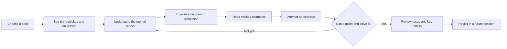
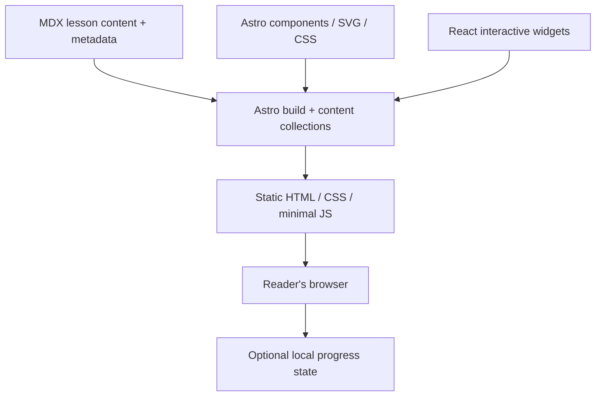

# Anvaya — Project Blueprint & Repository Bootstrap

> **A personal engineering learning platform — not merely a documentation site.**
>
> **Tagline:** Connect concepts. Build understanding.  
> **Learning loop:** Learn → Visualize → Experiment → Practise → Recall → Revisit.

| Field | Value |
| --- | --- |
| Project | **Anvaya** |
| Repository | `anvaya` (new/empty repository) |
| Document type | Product brief, architecture decision baseline, learning-experience specification, and executable bootstrap plan |
| Status | **Foundation and platform v2 implemented (ADRs 0003–0006); owner lesson review pending. Current progress: [IMPLEMENTATION.md](IMPLEMENTATION.md)** |
| Initial audience | One personal learner; architecture should remain maintainable and potentially open-sourceable |
| Date | 2026-10-27 |
| Initial focus | Data Structures & Algorithms (Arrays first); expandable to Haskell, System Design, Cloud, AI Engineering and more |
| Primary deployment | Static website, with private access when deployed remotely |

## 0. How to use this document

This file is the **bootstrap contract** for an engineering agent working in an initially empty Git repository. Its purpose is to establish the product vision, architectural constraints, user experience, engineering practices, and an incremental plan. It is **not** a request to generate hundreds of lessons or to build a complex platform in one pass.

**Instructions to the implementing agent:**

1. Read this complete document before scaffolding. Treat **Decisions** and **Acceptance criteria** as requirements; treat explicitly marked **Options / Later** as choices to evaluate, not work to implement immediately.
2. Inspect the actual repository state, available runtimes, package-manager versions, and any relevant existing files. Do not assume the repository is still empty.
3. Use current, compatible stable versions of libraries from official documentation; record exact resolved versions in the lockfile. Do not invent version numbers or pretend an unexecuted command has passed.
4. Implement in small, reviewable increments following the milestones below. Maintain a short implementation plan/checklist and update it as work proceeds.
5. Where possible, **run the application**, inspect it in a browser, test actual interactions, and improve what you see. Static source review alone is not visual or behavioral verification.
6. Do not introduce unnecessary infrastructure, paid services, databases, accounts, analytics, API keys, LLM calls at runtime, or server-side code execution for the MVP.
7. Never include proprietary company material, credentials, personal data, production identifiers, patient data, or copied private repository content in Anvaya. Previous engineering documentation sites are **design inspirations only**, not content to republish.
8. Do not push changes, create public deployments, change remote repository settings, provision infrastructure, or expose project content without explicit owner approval.
9. If the environment blocks dependency installation, browser execution, or other verification, identify the precise limitation and mark the result **unverified**; provide commands for reproducing checks locally.
10. Keep this blueprint current through small architectural decision records (ADRs) when significant decisions change. Avoid duplicating the same requirement across many files.

**Primary objective for the first implementation:** A clean, responsive Anvaya foundation with a genuinely useful and interactive **Arrays** lesson, a second lightweight sample lesson to prove scalability, tests, clear contribution/authoring guidance, and an automated quality gate.

---

## 1. Vision and product definition

Anvaya is a personal, Git-backed engineering learning platform where concepts are **understood, demonstrated, tested, applied, and retained**. A lesson is a designed learning experience, not a static note dump. Each lesson may contain explanations, annotated diagrams, interactive simulations, runnable examples or local labs, misconceptions, exercises, and concise revision material.

The owner intends to study topics incrementally and revisit them over months or years. Anvaya should progressively become a curated engineering knowledge base that is pleasant to browse, quick to search, and faithful to the owner's understanding.

### 1.1 Product promise

A future version of the owner should be able to:

- Locate a known concept in seconds.
- Regain the mental model in a few minutes without rereading an entire course.
- Interact with a diagram to understand *why* an algorithm or system behaves a certain way.
- Find a trustworthy code example and reproduce its output.
- Practise independently before viewing the solution.
- Identify related concepts, prerequisites, trade-offs, and common mistakes.
- Recognize what was personally studied, verified, and not yet mastered.

### 1.2 Product principles — non-negotiable

1. **Learning over documentation.** Each new feature must help comprehension, application, retention, or discovery; reject decorative complexity.
2. **Human understanding is canonical.** AI can accelerate drafting and implementation, but the owner validates important claims and performs some learning exercises independently.
3. **Visual where it adds explanatory value.** Diagrams and animation must clarify mechanisms; they must also have accessible text equivalents.
4. **Progressive disclosure.** Introduce intuition first, then the mechanism, implementation, trade-offs, and advanced details. Avoid intimidating walls of content.
5. **Accuracy and reproducibility.** Verify examples, stated complexity assumptions, commands, and links; be explicit about caveats and language-specific behavior.
6. **Composable, not templated into sameness.** A consistent shell and reusable primitives coexist with unrestricted custom lessons and simulations.
7. **Static-first, privacy-first, offline-friendly.** No backend is required for initial lessons. A production build should be distributable as static assets. Offline reading may be a later enhancement; `file://` parity is not promised.
8. **Git is the source of truth.** Learning content, exercises, design system, and engineering decisions are versioned and reviewable.
9. **Maintainability compounds.** Prefer shared components and structured lesson metadata to hand-maintained navigation, copied scripts, or huge bespoke HTML files.
10. **Small, finished increments.** One excellent lesson is worth more than 50 plausible but unverified pages.

### 1.3 Audience and scope

**MVP:** A single technically sophisticated learner using desktop and mobile browsers; no multi-user authentication inside the application. Remote access may be protected at the hosting edge.

**Potential future:** Optional public/open-source distribution of the framework and non-sensitive lesson content, multi-device progress sync, learning analytics, community content. These are **not** permission to build multi-user systems now.

### 1.4 Success measures (qualitative first)

- A lesson explains a concept clearly without relying on external videos for its core mechanism.
- A returning learner can obtain a concise recap in approximately 2–5 minutes.
- Examples and labs run as described, and interaction semantics are verified in tests.
- New lessons can be added without editing shared navigation by hand.
- The site is easy to read, navigate, and use with keyboard and on narrow screens.
- The baseline build, type checks, content validation, and automated tests pass.

Avoid optimizing page counts, time spent, engagement streaks, or visual novelty as primary success metrics.

---

## 2. Initial boundaries and non-goals

### In scope for the foundation

- Anvaya identity and coherent design system.
- Home/dashboard-style entry page with subject/learning-path cards and a prominent **Continue learning** area.
- Subject listing, topic ordering, lesson detail, related/prerequisite links, and minimal search/discovery strategy.
- MDX-based lessons backed by typed content collections.
- Reusable presentational components, rich SVG diagrams, and focused interactive learning islands.
- Arrays as a substantive golden-reference lesson with visual exploration, code, complexity, exercises, and recap.
- A second simple sample lesson to demonstrate data-driven routing/navigation.
- Source-controlled exercises/tests and basic client-side learning progress where justified.
- Accessible desktop/mobile layout, light/dark theme, essential testing, and CI.
- Static build and deployment instructions; optional private hosting after explicit authorization.

### Explicitly out of scope for the MVP

- Accounts, collaboration, subscriptions, forums, external identity provider inside Anvaya.
- Database, API service, CMS, search server, vector store, embeddings/RAG, chat assistant.
- Live arbitrary-code execution on a server, untrusted package installation, or privileged browser sandbox.
- Large-scale curriculum generation, auto-publishing lessons, flashcard scheduling engine, or cross-device progress sync.
- Proprietary content imports from engineering repositories, including DentXE or Agent Platform source code.
- Mobile native application, payments, telemetry, SEO-growth work, multi-tenancy, or elaborate gamification.

If a feature is not needed to make the **first two lessons excellent**, defer it.

---

## 3. Learning experience and information architecture

The owner-approved catalog refinement is recorded in
[ADR 0003](docs/adr/0003-subject-catalog-and-reference-design.md): category/subject
discovery is separate from ordered paths, paths may have sections, and canonical
lessons may be standalone or shared. The initial DSA hierarchy below illustrates
content, rather than limiting Anvaya to computer science.

### 3.1 Content hierarchy

```text
Anvaya
├── Home / Learning dashboard
├── Learning paths
│   ├── Data Structures & Algorithms
│   │   ├── Foundations
│   │   │   ├── Arrays              [golden lesson]
│   │   │   ├── Hash maps          [second sample]
│   │   │   ├── Linked lists       [future]
│   │   │   ├── Stacks & queues    [future]
│   │   │   └── Trees & graphs     [future]
│   │   └── Algorithms            [future]
│   ├── Haskell                   [future]
│   ├── System Design             [future]
│   ├── Cloud & Infrastructure    [future]
│   └── AI / Agent Engineering    [future]
├── Concepts (cross-path reference and search)
├── Labs / Practice (linked from individual lessons)
└── Revision (lesson summaries and questions; richer tracking later)
```

The same lesson should appear in relevant learning paths and concept searches **without copying its content**.

### 3.2 Core pages

| Surface | Primary question answered | MVP behavior |
| --- | --- | --- |
| Home | Where should I continue? | Subject cards, featured path, recently accessed/continue area with sensible empty state |
| Path detail | In what order should I study? | Ordered lessons, prerequisites, difficulty, estimated time, status |
| Lesson | How does this actually work? | Rich content, diagrams, examples, exercises, concise recap |
| Concept index | Where was that idea? | Searchable titles/tags or static filter; search implementation can be incremental |
| Lab | Can I implement this myself? | Task, constraints, example cases, local runner/test instructions, solution reveal after attempt |
| Revision | Can I recall it later? | Summary and self-check; lightweight state only initially |

### 3.3 Standard learning journey



**Do not** require all lessons to follow the same visual layout, but aim for the same educational outcomes. Short reference topics can omit an interactive component if none would improve understanding.

### 3.4 Required lesson anatomy

For a substantial concept lesson, prefer this order:

1. **Orientation:** title, short motivation, prerequisites, estimated reading/practice time, clear learning objectives.
2. **Intuition:** a short mental model or real-world analogy, with its limitations.
3. **Mechanism:** a labeled diagram, step-by-step illustration, or interactive demonstration where useful.
4. **Formal model:** definitions, assumptions, invariants, how it works internally.
5. **Implementation:** complete, readable, tested code in the chosen language(s), with expected outputs.
6. **Complexity and trade-offs:** time/space costs with best/average/worst assumptions where applicable.
7. **Real use cases:** where to use it, alternatives, failure modes, common misconceptions.
8. **Practice:** at least one independent exercise and an appropriately separated solution/hint.
9. **Check understanding:** a conceptual question or mini-quiz that tests reasoning instead of trivia.
10. **Revision:** key takeaways, compact cheat sheet, related concepts, and source references.

A lesson should not artificially expand to fill every section. Use a **conceptual checklist**, not a rigid page-length target.

### 3.5 Pedagogical standards

- Prefer **predict → reveal → explain** interactions rather than always showing the answer immediately.
- Encourage retrieval practice: ask the learner to state what happens before stepping an animation.
- Start from a small example, increase difficulty, and compare alternatives.
- Distinguish a conceptual array model from JavaScript/TypeScript runtime specifics.
- State invariants and complexity assumptions explicitly; avoid misleading universal claims.
- Provide concise, high-quality explanations of *why wrong answers are wrong*.
- Use spaced review as a design principle, but defer any scheduling engine until there is an actual learner need.
- When showing code, include language/version assumptions and avoid fabricated execution claims.

---

## 4. Architecture — approved baseline

### 4.1 Technology decisions

| Concern | Initial decision | Why |
| --- | --- | --- |
| Site framework | **Astro** | Static-first, custom layout freedom, limited JS by default |
| Structured lessons | **MDX**, with Astro content collections | Prose, frontmatter, versioning, embedded custom components |
| Layout / mostly static UI | **Astro components** | HTML/CSS/SVG control without unnecessary hydration |
| Rich stateful learning widgets | **React + TypeScript**, only where beneficial | Predictable component state and testability |
| Simple interactive diagrams | Inline SVG + small client-side TypeScript in Astro components | Preserves the custom, clickable documentation style without mandatory React |
| Styling | CSS variables and component-level styles; shared global tokens | Fidelity, theming, maintainability; avoid premature CSS framework dependency |
| Content metadata | Typed content collections with schema validation | Validated navigation and consistent learning metadata |
| Code quality | TypeScript strict mode, formatter, linter, tests | Prevent silent regressions |
| Client state | `localStorage` where useful, optional and versioned | No database or authentication needed |
| Search | Start with small static index; evaluate Pagefind when needed | No backend, avoid premature complexity |
| Deployment | Static assets | Cheap hosting and simple operations |
| Remote privacy | Hosting-edge access control, e.g. Cloudflare Access | Keep site private without application authentication |

**MDX does not replace HTML.** MDX authors the structured teaching narrative, while Astro `.astro` files retain detailed HTML/SVG freedom. React is an opt-in enhancement for complex stateful simulators. A fully custom Astro page is allowed for experiences dominated by visual UI. Do not force everything into MDX.

### 4.2 Rendering and interaction model



- Prefer server/build-time rendering for lesson content and static diagrams.
- Use small Astro browser scripts for low-complexity behavior (theme toggle, diagram selection, copy button).
- Use React islands for simulations with multiple coupled controls or interactive state transitions.
- Hydrate below-the-fold widgets only when appropriate (`client:visible`), preserving meaningful static explanatory content before hydration.
- No runtime network connection should be necessary to read core lessons on a loaded site. Remote hosting/login is a separate concern.

### 4.3 Known trade-offs and constraints

- Unlike the original hand-authored DentXE site, an Astro build **may not work by double-clicking an HTML file via `file://`** because asset paths or module loading can require an HTTP origin. Verify `pnpm dev` and static preview serving; consider offline/PWA support later.
- MDX uses JSX-compatible syntax; HTML snippets may require adjustments (e.g., class naming and self-closing tags). Prefer complex SVG in `.astro` components, not large inline MDX fragments.
- `.astro` components are **not React components** and cannot be hydrated via React directives. Client-side behavior can come from Astro `<script>` or a framework component.
- The deployable output is static, but **static does not mean private**. Authentication and URL/asset exposure are hosting concerns.

### 4.4 Tooling preferences

- **Package manager:** pnpm (single lockfile; record the actual package manager version via `packageManager` and supported tooling).
- **Runtime:** current supported Node.js LTS compatible with the selected Astro release; pin via `.node-version` or equivalent after checking the official requirements.
- **Formatting:** Prettier with Astro and MDX support, matching installed ecosystem versions.
- **Linting:** ESLint (TypeScript/React where used) and Astro-aware validation.
- **Static/type checking:** `astro check` plus TypeScript validation as appropriate.
- **Unit/component testing:** Vitest and React Testing Library when React widgets exist.
- **Browser E2E:** Playwright for a short, stable set of essential user flows.
- **CI:** GitHub Actions running installation, type/content checks, formatting/linting, build, unit tests, and one browser smoke suite.

Verify current package compatibility before installing; do not hardcode hypothetical versions into this blueprint.

### 4.5 External technical references

- Astro: https://docs.astro.build/
- Astro MDX: https://docs.astro.build/en/guides/integrations-guide/mdx/
- Astro content collections: https://docs.astro.build/en/guides/content-collections/
- Astro islands: https://docs.astro.build/en/concepts/islands/
- Cloudflare Access (public hostname): https://developers.cloudflare.com/cloudflare-one/access-controls/applications/http-apps/self-hosted-public-app/
- WCAG 2.2: https://www.w3.org/TR/WCAG22/

Official docs are authoritative for framework/API usage; examples here illustrate intent and should be adjusted to the installed versions.

---

## 5. Proposed repository structure

Use this as a **target**, not a requirement to create empty folders with no purpose.

```text
anvaya/
├── ANVAYA_BOOTSTRAP.md              # This file; bootstrap baseline
├── README.md                        # Project overview, local startup, links
├── AGENTS.md                        # Concise agent instructions pointing here
├── package.json
├── pnpm-lock.yaml
├── astro.config.mjs
├── tsconfig.json
├── src/
│   ├── content.config.ts            # Typed learning content schemas
│   ├── content/
│   │   ├── lessons/
│   │   │   └── dsa/
│   │   │       ├── arrays.mdx        # Golden-reference lesson
│   │   │       └── hash-maps.mdx     # Small second lesson
│   │   └── paths/                   # Structured learning paths, as needed
│   ├── pages/
│   │   ├── index.astro
│   │   ├── paths/index.astro
│   │   ├── paths/[slug].astro
│   │   ├── learn/[...slug].astro
│   │   └── concepts/index.astro
│   ├── layouts/
│   │   ├── BaseLayout.astro
│   │   └── LessonLayout.astro
│   ├── components/
│   │   ├── shell/                    # Header, Sidebar, Breadcrumbs, TOC
│   │   ├── learning/                 # ObjectiveList, KeyTakeaways, Quiz, etc.
│   │   ├── diagrams/                 # SVG illustrations, clickable diagram
│   │   ├── interactive/              # ArrayExplorer.tsx + tests
│   │   └── ui/                       # Card, Callout, Tabs, CodeBlock, etc.
│   ├── data/                         # Ordered paths / minimal curated taxonomy
│   ├── lib/                          # Content helpers, state, schemas
│   ├── styles/                       # Tokens, global styles, component styles
│   └── assets/                       # Optimized source images/icons
├── public/                           # Static files not processed by bundler
├── labs/
│   └── dsa/arrays/                  # Exercises and runnable tests
├── tests/
│   ├── unit/
│   └── e2e/
├── scripts/                          # Content/link validation if needed
├── docs/
│   ├── adr/                          # Architecture decisions
│   ├── AUTHORING_GUIDE.md
│   ├── DESIGN_SYSTEM.md
│   ├── LEARNING_STANDARDS.md
│   └── DEPLOYMENT.md                 # Created when deployment is configured
└── .github/workflows/quality.yml
```

**Naming conventions:** kebab-case for URLs, lesson slugs, and filenames; PascalCase for UI components; clear singular names for types. Keep permalinks stable. A move/rename must update references or include a redirect strategy when content becomes externally linked.

---

## 6. Content model and learning paths

### 6.1 Content must be validated, not inferred from filenames alone

Use Astro's current **content collections** approach with the filesystem `glob()` loader. An illustrative schema (adapt to actual Astro version) is:

```ts
// src/content.config.ts — illustrative baseline
import { defineCollection } from 'astro:content';
import { glob } from 'astro/loaders';
import { z } from 'astro/zod';

const lessons = defineCollection({
  loader: glob({
    base: './src/content/lessons',
    pattern: '**/*.{md,mdx}',
  }),
  schema: z.object({
    title: z.string().min(3),
    summary: z.string().min(15),
    subject: z.string().min(2),
    path: z.string().min(2),
    difficulty: z.enum(['foundation', 'intermediate', 'advanced']),
    estimatedMinutes: z.number().int().positive(),
    learningObjectives: z.array(z.string().min(5)).min(1),
    prerequisites: z.array(z.string()).default([]),
    tags: z.array(z.string()).default([]),
    status: z.enum(['draft', 'reviewed', 'published']).default('draft'),
    reviewedAt: z.coerce.date().optional(),
    sources: z.array(z.object({
      label: z.string(),
      url: z.string().url(),
    })).default([]),
  }),
});

export const collections = { lessons };
```

Frontmatter example:

```yaml
---
title: "Arrays: Fundamentals and Mental Models"
summary: "Understand indexed storage, key operations, cost models, and practical trade-offs."
subject: "dsa"
path: "dsa-foundations"
difficulty: "foundation"
estimatedMinutes: 45
learningObjectives:
  - "Explain indexed access and its assumptions"
  - "Compare traversal, insertion, deletion, and lookup costs"
  - "Implement and test common array operations"
prerequisites: []
tags: ["arrays", "complexity", "memory", "foundations"]
status: "draft"
sources:
  - label: "A verified primary textbook or language reference"
    url: "https://example.org/replace-before-publishing"
---
```

**Important:** The example URL is a placeholder to **replace or remove** before publishing. Do not claim a source was consulted when it was not. Never seed real content with fabricated citations.

### 6.2 Learning path model

Keep ordered curricula separately from canonical lesson files, e.g. a typed `paths` collection or small TypeScript data structure. It should provide:

- `id`, `title`, `description`, optional `icon`/theme.
- Ordered lesson IDs and/or section/group IDs.
- Prerequisite relationships, without cyclic dependencies.
- Optional recommendation links such as “continue with Hash Maps.”

Generate navigation, learning-path cards, breadcrumbs, previous/next, and related links from shared data. Do not manually maintain the same links in multiple page templates.

### 6.3 State and review model

Distinguish **content status** (draft/reviewed/published) from **learner progress** (not started/in progress/practised/reviewed). Content status belongs in Git; learner progress belongs in browser storage for MVP.

For local progress state:

- Use a versioned storage key such as `anvaya:progress:v1`.
- Persist only simple non-sensitive per-lesson data such as last opened, completed checks, or user-selected state; document schema and migration/clear behavior.
- Handle storage disabled, corrupt, or cleared gracefully; never make progress storage necessary to access lessons.
- Treat local progress as **device/browser-specific**. No misleading cross-device synchronization claim.

Avoid building a spaced repetition database at this stage. A “Mark practised” control and a revision recap are enough to test the workflow.

---

## 7. Visual design and interaction standards

### 7.1 Inspiration to retain

Anvaya should pursue the same **high-fidelity teaching quality** demonstrated by the owner's existing HTML documentation sites for the DentXE infrastructure and agent platform repositories, particularly the OpenTofu/Terraform tutorial:

- A clear hero with title, audience, and prerequisites.
- Persistent yet unobtrusive navigation and in-page table of contents.
- Custom themed SVG diagrams with clickable nodes and contextual explanation panels.
- Annotated source/code diagrams, “what happens” flows, comparisons, and callouts.
- Practical labs and correct expected outcomes.
- Light/dark theme, responsive cards, usable typography, and copy controls.

These are **experience requirements**, not permission to copy private business content into this personal project.

### 7.2 Design tokens and system

Define centralized CSS custom properties for at least:

- Background, elevated surface, subtle surface, text, muted text, borders.
- Accent, success, warning, error, information and their soft backgrounds.
- Diagram semantic colors and graph edge/arrow colors.
- Typography families, scale, line heights, paragraph measure (roughly 65–80 characters).
- Spacing scale, radii, shadows, breakpoints, sticky header/sidebar offsets.
- Focus ring, reduced-motion variants, and code syntax background.

Prefer **system fonts and local assets** for speed and privacy. Avoid remote fonts/CDNs by default. Use meaningful responsive breakpoints based on layout behavior, not device brands.

### 7.3 Experience quality

- Clear information hierarchy: path → lesson → section → exercise → recap.
- Provide a “this is interactive” hint where affordances are not obvious.
- On desktop, favor readable article measure, useful side navigation and in-page outline; on mobile, collapse navigation without hiding content.
- Components must have intuitive empty, loading, error, success and reset states if those states apply.
- Support theme modes **system / light / dark**; persist preference unobtrusively.
- Avoid large motion by default; honor `prefers-reduced-motion` and provide a way to step through animations manually.
- Keep content usable at 200% zoom without horizontal scrolling (except intentionally scrollable code blocks or diagrams with accessible alternatives).
- Use SVG text labels or descriptions; do not rely on color alone.
- All important functionality must be keyboard accessible, with visible focus and appropriately announced state changes.

### 7.4 Component strategy (minimum useful library)

| Component | Type | Behavior and contract |
| --- | --- | --- |
| `LessonHero` | Astro | Title, description, prerequisites, metadata and optional progress |
| `SectionTOC` | Astro + minimal JS | Stable anchor links and active section, keyboard-friendly |
| `Callout` | Astro | Semantic information/warning/tip variants |
| `DiagramFrame` | Astro | Caption, alt/description, optional legend, overflow handling |
| `ClickableDiagram` | Astro + small TypeScript | SVG hotspots, selection, accessible info panel and keyboard support |
| `CodeExample` | Astro | Syntax, language, tested output, copy action, accessible label |
| `ComplexityTable` | Astro | Operation/average/worst/space and assumptions |
| `ConceptCheck` | Astro or React | Question, user response, explanation, optional retry |
| `KeyTakeaways` | Astro | Concise revision bullets, no heavy interaction |
| `ArrayExplorer` | React island | Stateful array operations and guided step-by-step exploration |
| `LabCard` | Astro | Problem, constraints, tests and progressive hints |

**Reusability rule:** Abstract patterns that recur or have meaningful behavioral complexity. Do not build a huge generic component framework for hypothetical future lesson types.

### 7.5 Accessibility requirements

Use **WCAG 2.2 AA** as an engineering target where applicable. At minimum:

- All interactive SVG nodes accessible via buttons or keyboard-operable targets with clear accessible names and focus indication.
- Visible panel state is expressed without solely changing fill color; announce updates appropriately where useful.
- Semantic headings, landmarks, labels, focus order, skip-to-content, and discernible controls.
- Correct text/background contrast in all supported themes.
- Motion control and static text equivalents for animated algorithm state.
- Usable mobile touch targets and no hover-only essential interaction.

Test representative flows with keyboard alone and at least one automated accessibility scan where tooling permits.

---

## 8. Golden-reference lesson: Arrays

**This is the first substantial learning deliverable.** It must be genuinely educational, not a placeholder created only to demonstrate the route.

### 8.1 Outcomes

After completing the lesson, the learner should be able to:

1. Describe indexed access and the simplified contiguous-array memory model.
2. Explain why indexed read/write is typically `O(1)` under its model.
3. Explain traversal/search costs and how insertion/deletion causes shifting.
4. Distinguish static/fixed-size arrays, dynamic arrays, and JavaScript's language-level `Array` behavior.
5. Work through a dynamic array resize example and describe amortized append cost and worst-case resize.
6. Implement common operations in TypeScript and verify edge cases.
7. Compare arrays with linked lists/hash maps for concrete use cases.
8. Solve at least one exercise independently and explain complexity assumptions.

### 8.2 Required content sections

- **Why arrays exist:** use case and simple mental model.
- **Index and address model:** labeled visualization; note that machine-level representations vary.
- **Operations:** read, update, linear search, append, insert, remove, iterate.
- **Cost analysis:** worst/average/amortized distinctions, space overhead, caveats.
- **Dynamic growth:** capacity vs logical length, resizing, copying.
- **Examples:** small tested TypeScript examples and explicit results.
- **Patterns:** brief introduction to two pointers and sliding windows as *related future lessons*, not unexplained jargon.
- **Pitfalls:** off-by-one, mutability, empty input, out-of-range, comparing values, wrong complexity assumptions.
- **Practice:** at least two exercises with independently verifiable tests.
- **Recall:** 3–5 questions and a two-minute summary.
- **Sources:** authoritative references with accurate citations/links.

### 8.3 Arrays interactive explorer — functional requirements

Allow a learner to:

- See a small collection of cells with clear **index**, **value**, **logical length**, and optionally **capacity**.
- Select an index to inspect its value and understand constant-time indexed access.
- Apply **read, update, append, insert, remove, and reset** controls.
- Step through an insertion/deletion showing each affected element shifting; use animation only as a teaching aid and provide a non-animated step mode.
- Choose or type safe example values within explicit limits; give clear validation errors rather than crashing.
- See an accompanying **operation explanation** and **complexity statement** that updates with the chosen operation.
- Optionally demonstrate capacity doubling with a toggle for the conceptual dynamic-array model.
- Pause/restart or reset to a deterministic initial example; ensure all state transitions are testable.

**Important correctness caveat:** Do not claim JavaScript arrays necessarily expose a contiguous-memory guarantee. The visualization describes the textbook array/dynamic-array abstraction; language-specific notes clarify differences.

### 8.4 Teaching-quality acceptance scenario

> Start with `[12, 24, 36, 48]`. Choose **insert `30` at index `2`**. Show elements shifted right, display the resulting `[12, 24, 30, 36, 48]`, distinguish inserted value and shifted elements, and explain that indexed access and middle insertion have different complexities. Then reset and test empty input, insertion at end, invalid index, and removal.

Acceptance depends on **both** computational correctness and a readable, accurate visual explanation.

### 8.5 Second sample lesson

Create a smaller **Hash Maps: Fundamentals** lesson, with metadata, a coherent explanation, one tested implementation or example, a complexity caveat, and links from the learning path. Its role is to verify that another lesson can be added with minimal new infrastructure. No advanced hash-table animation is needed yet.

---

## 9. Labs, examples, and code execution safety

### 9.1 First release: reproducible local labs

Place practice code in `labs/<subject>/<lesson>/`, with clear instructions and executable tests. A lab should include:

- Goal and expected prior knowledge.
- Problem statement, input/output contract, constraints and example cases.
- Starter implementation or TODOs.
- Commands to run **without** requiring cloud accounts or production credentials.
- Unit tests for normal, boundary, and invalid cases.
- Optional hints; solution separated so it does not spoil the attempt immediately.
- A short explanation of complexity and why the solution works.

Examples shown in a published lesson must correspond to verified tests or reproducible commands. Where code is illustrative rather than actually executed, label that distinction.

### 9.2 Browser playground is optional, not a prerequisite

A future browser-based playground may be useful, but do not implement untrusted code evaluation casually. **Never** execute arbitrary lesson/user code with `eval`, unrestricted `new Function`, server shell access, or elevated origin privileges. Select a vetted isolation model with appropriate sandboxing and resource limits if/when an in-browser execution feature is approved.

For the MVP, copied examples + local labs + interactive **controlled simulations** already provide significant educational value.

---

## 10. Knowledge quality, sources, and AI-assisted authoring

### 10.1 Roles and responsibilities

- **Learner/owner:** selects what matters, studies the subject, attempts exercises, approves conceptual claims, resolves ambiguities, decides publication readiness.
- **Research/teaching AI:** suggests outline, analogies, misconceptions, source candidates, questions, diagrams, and draft explanations; explicitly flags uncertain claims.
- **Coding agent:** implements components, lesson content structure, tests, diagrams, formatting, and consistency checks; reports what was actually verified.
- **Automated checks:** detect schema/MDX errors, broken links, build failures, accessibility regressions, and code-example mismatches where covered.

### 10.2 Per-lesson creation workflow

1. **Select concept and learning goal.** Define what the learner should explain or implement after completion.
2. **Study independently or collaboratively.** Capture the owner's own examples, questions, confusions, and insights in scratch material if needed.
3. **Research and verify.** Consult trusted primary references; clearly separate established fact from helpful simplification.
4. **Draft the teaching plan.** Identify concepts, mechanism, visual opportunity, code, exercise, and recap.
5. **Implement the lesson.** Write MDX, compose shared components, add bespoke Astro/SVG/React interactions only as educationally justified.
6. **Test.** Run unit tests, content validator, production build, responsive and keyboard checks, and browser interaction tests where appropriate.
7. **Review for pedagogy and accuracy.** Ask: could the reader understand this and practise without the author present?
8. **Publish/mark reviewed.** Promote status only after genuine review; do not stamp all AI-generated pages “reviewed.”
9. **Revisit.** Fix inaccuracies, improve visual explanations, and maintain source references as understanding evolves.

### 10.3 Authoring contract for AI agents

When producing or updating a lesson, the agent **must**:

- Reuse the shared layout, typography, theme, and metadata conventions.
- Check any existing related lessons and use stable cross-links.
- Explain correctness and complexity with assumptions; avoid overconfident, universal claims.
- Prefer explanations in the owner's words and code when available; do not fabricate personal experiences.
- Build diagrams with meaningful labels, legends, captions, and accessible alternatives.
- Prefer conceptual interactions over decorative animations.
- Supply tests for algorithm behavior and deterministic widget state transitions.
- Avoid copying long passages or proprietary examples from sources; link and attribute appropriately.
- Mark claims or examples **unverified** when execution/research cannot be completed.
- Not generate an entire curriculum until individual templates prove effective.

### 10.4 Lesson review checklist

- [ ] The stated learning objectives are testable by explanation or exercise.
- [ ] The introduction gives a clear reason to learn this concept.
- [ ] Diagrams/animations accurately represent the model being taught.
- [ ] Abstractions and language-specific behaviors are not conflated.
- [ ] All complexity claims state their relevant conditions.
- [ ] Code samples and examples are verified or marked illustrative.
- [ ] Exercises contain edge cases and are solvable from supplied knowledge.
- [ ] Questions test understanding, not just memorization.
- [ ] The recap lets a returning reader regain the idea quickly.
- [ ] Sources are real and appropriate; no hallucinated citations.
- [ ] Content is accessible, readable in both themes, and responsive.
- [ ] Internal links and metadata pass validation.

### 10.5 Source of truth policy

For Anvaya, the **source-controlled lesson MDX/code/tests and approved ADRs** are authoritative; generated HTML is a build artifact. Scratch notes and AI chat transcripts are input material, not automatic published truth. Automated tests validate code behavior but do **not** establish all educational explanations are correct. Human review remains required for significant conceptual assertions.

---

## 11. Engineering standards and quality gates

### 11.1 Source quality

- TypeScript `strict` mode; avoid `any` unless documented and justified.
- Separate algorithm/domain logic from visualization state to make it unit-testable.
- Keep components focused and composable; avoid enormous lesson components containing prose, diagrams, controls, and algorithm logic together.
- Define clear interfaces for interactive widgets and use deterministic sample datasets.
- No runtime dependency on AI, paid APIs, trackers, or external CDNs in the core learning experience.
- Use scoped module styles / tokens rather than ad hoc per-page globals; avoid style collisions.
- Prefer semantic links/buttons over clickable `div` elements.
- Validate user input and handle edge cases in both the logic and UI.
- Keep bundle size proportional to educational benefit; heavy widgets should load on demand.

### 11.2 Suggested scripts

Provide scripts with these **stable names** in `package.json` and make sure each actually works:

```json
{
  "scripts": {
    "dev": "astro dev",
    "build": "astro build",
    "preview": "astro preview",
    "check": "astro check",
    "lint": "eslint .",
    "format": "prettier --write .",
    "format:check": "prettier --check .",
    "test": "vitest run",
    "test:e2e": "playwright test"
  }
}
```

Add or adapt scripts to the installed toolchain, and do not keep nonfunctional placeholder scripts merely for appearances. Use `pnpm` consistently.

### 11.3 Test pyramid

**Unit tests**

- Pure DSA array operations: read/update/insert/remove/append, boundaries, invalid indices, empty/full conceptual capacity behavior.
- Learning-path ordering and prerequisite/cross-link utilities.
- Progress storage serialization/migration/fallback where implemented.
- Complexity descriptions/constants if represented as data.

**Component tests**

- State change and reset in `ArrayExplorer`.
- Insert/remove sequence and accessible explanations.
- Keyboard operation and visible selection behavior in clickable diagrams.
- Quiz feedback and retry when quizzes are present.

**E2E/browser tests**

- Home → path → Arrays lesson navigation works.
- TOC anchor and sidebar behave on desktop/mobile.
- Toggle system/light/dark without losing readability.
- Click a diagram node and verify the correct info panel, then use keyboard to select another.
- Insert into an array, step through the transition, and reset.
- Open a second lesson and follow previous/next links.
- No severe console errors or failed local requests during core flows.

**Visual verification**

- Capture representative screenshots at desktop and mobile widths, in both themes.
- Check typography, SVG legibility, overflow, sticky navigation, diagrams, focus indication, reduced motion, and interactive state—not just whether the page compiles.
- Prefer baseline screenshots after intentional design review rather than auto-accepting every changed screenshot.

### 11.4 Content and documentation validation

At minimum, fail CI for:

- Invalid content schema and missing required frontmatter.
- Broken internal page links or anchors where the validator can inspect them.
- Duplicate routes/slugs/IDs.
- Broken imports or MDX compilation errors.
- React/TypeScript errors in supported checks.
- Lint/format failure.
- Failed code/unit/interaction tests.
- Failed production build.

Add semantic content checks (missing image alternatives, incomplete source placeholders, no objectives or recap) where maintainable and not overly noisy.

### 11.5 CI rules

- Run on pull requests and the default branch.
- Use least-privilege GitHub Actions permissions (read-only by default), pinned or otherwise secured third-party actions, and the committed lockfile.
- Cache dependencies safely; `pnpm install --frozen-lockfile` in CI.
- Keep secrets out of forked PR jobs and never require deployment credentials to run the quality suite.
- Put deployment into a **separate** explicitly authorized workflow, gated on quality passing.
- Avoid CI that silently rewrites/generated-commits source files.

---

## 12. Hosting, privacy, security, and licensing

### 12.1 MVP operations

- Local use: `pnpm dev` for authoring and `pnpm build` / `pnpm preview` for production behavior.
- Static hosting after approval: Cloudflare Pages is a reasonable candidate, but not a prerequisite for local development.
- If accessible remotely, use authentication **before any private content or asset is exposed**. Cloudflare Access is one possible edge-level gate for the site.
- Verify the **production custom hostname, default Pages hostname, branch previews, and deployment previews** are protected or disabled as appropriate. Test as an unauthenticated user; protecting only the preview does not secure every URL.
- Do not assume a private GitHub repository makes a published static website private.
- If using a domain, document DNS/hosting requirements and any ongoing costs separately; “free-tier eligible” is not a promise of zero-cost domains or permanent plan availability.

### 12.2 Data boundaries

- No personal API keys, credentials, identifying logs, unpublished company architecture, customer information, or proprietary code in lesson content or assets.
- No runtime learner tracking or third-party analytics by default.
- Treat browser storage as convenience, not secure storage or permanent backup.
- Add a clear plan for deleting local progress and documenting its scope.
- Sanitize user-provided text before insertion into the DOM; do not render untrusted HTML arbitrarily.
- Maintain dependency updates and basic supply-chain hygiene.

### 12.3 Open-source readiness (future, not automatic)

Keep the framework generally usable outside the owner's machine, separate branding/configuration from content, and avoid hardcoded secrets/paths. **Do not select or publish an open-source license without an explicit owner decision.** A private repository is not implicitly licensed for public reuse. Review all lesson sources, images, snippets, and third-party assets before any public release.

---

## 13. Implementation plan and deliverables

This is the original bootstrap acceptance checklist. Execution status and subsequent
increments are maintained in [IMPLEMENTATION.md](IMPLEMENTATION.md); unchecked
boxes below are not a current backlog. Lesson acceptance still requires owner review.

### Milestone 0 — Discover and plan

**Objective:** Establish safe, reproducible project setup.

Tasks:

- [ ] Inspect repository, git state, environment, tools, and current Astro prerequisites.
- [ ] Confirm package manager/runtime and initialize supported versions.
- [ ] Record short ADRs for static-first architecture and content source of truth.
- [ ] Create a short milestone checklist that matches this document.

**Done when:** The agent can explain what it will build, required versions are grounded, and no accidental remote/deployment side effects occurred.

### Milestone 1 — Functional application foundation

**Objective:** A recognizable, responsive, deployable Anvaya shell.

Tasks:

- [ ] Bootstrap Astro + MDX and add React only for actual interactive components.
- [ ] Establish TypeScript, package manager lockfile, formatter/linter/checker, test setup.
- [ ] Add brand styling, base layout, navigation, theme switch, responsive sidebar and TOC.
- [ ] Define typed lesson metadata and path model; generate routes/navigation from content.
- [ ] Build home, learning path, lesson layout, and concept index, each with useful empty states.
- [ ] Ensure static build works and local production preview serves assets correctly.

**Done when:** A reader can move Home → DSA path → lesson and back, with accessible desktop/mobile navigation and both themes.

### Milestone 2 — One excellent Arrays lesson

**Objective:** Validate educational quality and rich interaction fidelity.

Tasks:

- [ ] Write the complete Arrays lesson structure and accurate technical content.
- [ ] Implement the reusable diagram container and a keyboard-operable clickable SVG diagram.
- [ ] Build `ArrayExplorer` with deterministic read/insert/remove/update/append/reset and guided steps.
- [ ] Add complexity table, worked code examples, edge cases, two local exercises with tests, questions, recap.
- [ ] Verify actual rendered UI and interactions in browser; revise defects.
- [ ] Create smaller Hash Maps sample lesson and ensure both lessons appear in a data-driven learning path.

**Done when:** The lesson is useful for genuine study, interactive behavior works, and examples and claims have been reviewed—not merely rendered.

### Milestone 3 — Authoring and quality workflow

**Objective:** Make future lesson addition boring and reliable.

Tasks:

- [ ] Create `AUTHORING_GUIDE.md` with lesson outline, frontmatter schema, component catalog and AI-review procedure.
- [ ] Document design tokens, states, diagrams and accessibility rules.
- [ ] Add content validation, basic unit tests, browser smoke tests, and CI.
- [ ] Add a small reusable lesson-starter template or generator **only** if it reduces actual repeated effort.
- [ ] Document local startup, build, preview, and troubleshoot commands in README.

**Done when:** A third lesson can be introduced primarily as a content file, a learning path entry, and only genuinely necessary new components; CI verifies its quality envelope.

### Milestone 4 — Revision and private deployment (optional follow-on)

**Objective:** Improve long-term retention and remote access after the foundation proves useful.

Candidates, to select based on real use:

- [ ] Local-only per-lesson progress and last-reviewed markers.
- [ ] Quick-revision view aggregating published lesson takeaways and self-checks.
- [ ] Static search indexing (e.g., Pagefind) if the content volume warrants it.
- [ ] Private static hosting with complete access control and security checks.
- [ ] Offline/PWA support if remote connectivity proves limiting.

**Do not** block Milestones 1–3 on these enhancements.

---

## 14. Definition of done: foundation release

A foundation release is ready **only if** all of these are true:

### Product / learning

- [ ] Visual brand reads as **Anvaya**, without prior prototype/product names.
- [ ] The core learning path is obvious from the home page.
- [ ] Arrays is a substantive tutorial with explanation, mental model, diagrams, code, complexity, practice, and recap.
- [ ] A second lesson demonstrates the architecture is reusable.
- [ ] User can operate and reset the Arrays simulation and understand what changes.
- [ ] No knowingly incorrect or unverified claims are presented as established fact.

### UX / accessibility

- [ ] Works at common desktop and mobile viewports without accidental horizontal page scrolling.
- [ ] Both light and dark themes are coherent; system preference works.
- [ ] Keyboard works for navigation and essential interactions.
- [ ] Clickable SVG hotspots have accessible equivalents and state feedback.
- [ ] Motion is not required to understand an operation; reduced-motion is respected.

### Engineering

- [ ] `pnpm install --frozen-lockfile` succeeds in a clean environment.
- [ ] `pnpm check`, formatting check, lint, unit tests, production build, and selected E2E tests pass.
- [ ] Internal links/routes work; no duplicate slugs.
- [ ] Critical code examples have tested expected results.
- [ ] No runtime API keys, proprietary content, analytics, or inadvertent network dependencies.
- [ ] README and authoring documentation describe exactly how to run and extend the project.
- [ ] No publicly accessible deployment has been created without approval.

### Evidence to report back

- The final source structure and notable decisions.
- Commands run and their actual results (pass/fail/not run).
- Browser verification notes and screenshots when feasible.
- What remains out of scope, any known limitations, and the next recommended single lesson.

---

## 15. Engineering-agent execution brief (copy/paste)

The following can be given directly to an agent after placing this file in the repository:

```text
You are bootstrapping Anvaya, a personal engineering learning platform, in this repository.

First, read ANVAYA_BOOTSTRAP.md fully. It is the approved product and architecture baseline.
Inspect the repository and environment before changing files. This is a learning platform,
not a generic docs site. Preserve full custom HTML/SVG flexibility via Astro, use MDX for
structured explanations, and use React islands only for meaningfully stateful interactions.

Execute Milestones 0–3 incrementally, beginning with a functioning foundation and then one
excellent Arrays lesson plus a smaller Hash Maps example. Do not generate dozens of shallow
lessons. Prioritize pedagogical accuracy, responsive design, keyboard access, real browser
interaction testing, reproducible labs, and clean engineering practices. Maintain an
implementation checklist as you progress.

Use supported compatible stable dependencies and a committed pnpm lockfile. Create the
schema, layouts, components, tests, CI, README, and authoring guide as specified. Do not
introduce a backend, database, remote AI services, telemetry, or runtime code execution.

Treat existing DentXE Infra / Agent Platform HTML docs as quality and interaction
inspiration only. Do not copy or publish their private content or secrets. Do not push,
deploy, or change remote settings without owner approval.

Run the actual checks and, if possible, a browser verification cycle. Report measured
results and explicitly mark blocked/unverified checks. Finish with a concise description
of what is working, what remains, and any ADR-level decisions that need the owner's input.
```

---

## 16. Decisions log, open choices, and change control

### 16.1 Decisions already made

| ID | Decision | Reason |
| --- | --- | --- |
| D-001 | Project name is **Anvaya** | Distinctive, broad enough for lifelong learning |
| D-002 | Learning-first, not documentation-first | Retention and practice matter more than note volume |
| D-003 | Astro + MDX + native Astro components; selective React | Combines structured content with unrestricted custom experiences |
| D-004 | Git-backed content, static-first hosting | Simplicity, portability, version control |
| D-005 | One excellent Arrays lesson first | Proves design and educational quality |
| D-006 | Private by default | Personal learning material should not accidentally become public |
| D-007 | AI-assisted drafting, human-approved understanding | Protects accuracy and active learning |
| D-008 | No backend/database/account system in MVP | Avoids unrelated complexity |

### 16.2 Open decisions — defer until justified

- Exact final colors/logo/brand symbol: use a polished initial design token system, then adjust after browser review.
- Hosting provider, hostname, and authentication policy: decide only when requesting remote deployment.
- Whether the **framework**, **selected public lessons**, or **entire content base** should later be open-sourced.
- License for future public release.
- Full-text search package and offline/PWA caching policy.
- Future language tabs for implementations beyond TypeScript (Haskell, Python, etc.).
- Future progress sync, optional spaced repetition, and AI-assisted research features.

For a new significant architectural decision, add a brief ADR covering context, options, selected approach, trade-offs, and consequences. Avoid reopening an approved decision without a concrete new constraint.

---

## 17. Risks and mitigations

| Risk | Consequence | Mitigation |
| --- | --- | --- |
| Documentation becomes a page-generation exercise | Weak learning value | Require objectives, exercises and genuine learner review |
| MDX feels restrictive for custom pages | Reduced visual fidelity | Place rich diagrams in Astro and simulations in selectively hydrated components |
| AI-generated claims or examples are wrong | Mislearning | Source verification, tested code, explicit assumptions, manual sign-off |
| Content/navigation drift | Broken learning paths | Typed collections, generated links, build-time validation |
| Overengineering platform features | Time lost before studying | Strict MVP boundaries and staged delivery |
| Full React SPA grows heavy | Slow pages and complexity | Astro static-first islands and lazy hydration |
| Browser storage is lost | Progress disappears | Document local-only semantics, keep content independent of storage |
| Private learning content leaks through hosting | Privacy breach | Protect all hostnames/assets, verify unauthenticated access, no automatic deployment |
| Visual experience diverges on mobile | Poor usability | Responsive tests, keyboard checks, accessible non-animated alternatives |
| Stale code/tool instructions | Broken labs | CI, pinned lockfile, regular verified revision |

---

## 18. Completion and next steps

At the end of the initial bootstrap, Anvaya should be a **small but credible learning product**: an attractive home, an ordered learning path, an exemplary Arrays tutorial with a working simulator, a second example lesson, predictable authoring conventions, and a reliable validation loop.

The next normal task should then be **learning a real new subject and adding its next lesson**, not continuously rebuilding the platform.

**Product north star:** *Anvaya succeeds when it makes the learner better at understanding and applying engineering concepts—not when it produces the most pages.*
